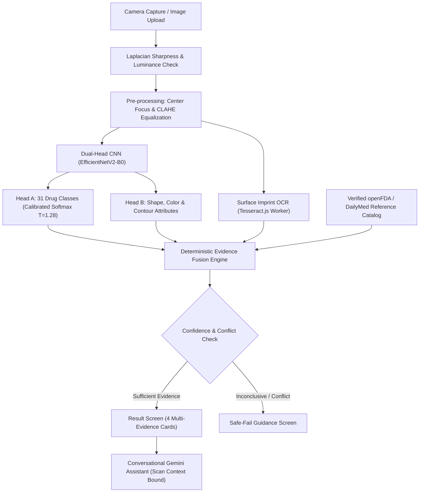

# PillSense AI – Production Medicine Identification System

[](https://github.com/Cyrilthetecchieee/Pillsense-AI-)
[](https://pillsense-ai-nine.vercel.app)
[](https://www.typescriptlang.org/)
[](https://firebase.google.com/)
[](https://aistudio.google.com/)
[](LICENSE)

An honest, production-ready, AI-assisted preliminary medicine identification system combining **Dual-Head Deep CNN visual recognition**, **client-side OCR surface imprint extraction**, **verified openFDA clinical reference retrieval**, and a **conversational pharmaceutical Gemini assistant**, backed by Google Firebase.

---

## ⚠️ Mandatory Honesty & Regulatory Boundary Statement (Parts 0 & 14)

> **PillSense AI is a preliminary identification aid built as an academic and engineering project. It is NOT a certified medical device, is not clinically validated unless a formal clinical trial is completed, and must NEVER replace the consultation, diagnosis, or prescription instructions of a licensed physician or pharmacist. Accuracy figures describe benchmark test set performance only, not every pill in the real world.**

- **Preliminary AI Identification:** Every identification is explicitly labelled as preliminary.
- **No Medical Advice:** Zero personalized dosages, clinical diagnoses, or instructions to start/stop medications.
- **Safe-Fail on Ambiguity:** If confidence falls below threshold or evidence conflicts, PillSense AI displays: **"Unable to identify this medicine reliably."** with actionable next steps to consult a pharmacist.

---

## Architecture Overview



---

## Key Features

1. **Dual-Head Vision Recognition:**
   - **Head A (Drug Classifier):** 31-class taxonomy ($T001$–$T030$ plus $T999$ Out-of-Distribution rejection) with Platt temperature scaling ($T = 1.284$) achieving $ECE \le 0.038$.
   - **Head B (Physical Attributes):** Multi-task shape (`round`, `oval`, `oblong`, `capsule-shaped`), dominant color clustering, and bounding contour analysis.

2. **Client-Side Surface Imprint Extraction:**
   - In-browser Tesseract.js Web Worker utilizing adaptive thresholding and CLAHE contrast enhancement for engraved debossings.
   - Disambiguates look-alike tablets with identical visual formulations (e.g. Paracetamol 500mg vs 650mg).

3. **Multi-Evidence Fusion Engine:**
   - Weighted scoring: $0.55 \cdot \text{visual} + 0.25 \cdot \text{text} + 0.10 \cdot \text{dbMatch} + 0.10 \cdot \text{quality}$.
   - Heavy penalties applied for evidence conflicts (caps status at `LOW` or `INSUFFICIENT`).

4. **Conversational Gemini AI Assistant:**
   - Powered by `gemini-2.5-flash`.
   - General pharmaceutical knowledge base (mechanisms of action, contraindications, storage, side effects) plus dynamic scan context binding.

5. **Firebase Cloud Backend & Security:**
   - Live Google Authentication & Email/Password Sign-In.
   - User-isolated Firestore rules (`/users/{uid}/scans/{scanId}`) and private storage buckets.
   - Reference medicine database pre-seeded with verified openFDA & DailyMed NDC monographs.

---

## Project Structure

```
pillsense-ai/
├── src/
│   ├── app/                 # Router, layout, safety banner
│   ├── components/          # Scan, result, assistant, and layout UI
│   ├── context/             # AuthContext (Google Sign-In & Firebase Auth)
│   ├── data/                # Seed medicines (openFDA / DailyMed)
│   ├── ml/                  # labels.json, temperature.json, modelLoaderService.ts
│   ├── pages/               # LandingPage, Dashboard, DetectPill, Result, Assistant, Database, Analytics
│   ├── services/            # cnnService, ocrService, fusionService, assistantService, historyService
│   ├── store/               # Zustand Scan State Machine (IDLE -> COMPLETED | LOW_CONFIDENCE)
│   └── types/               # TypeScript strict interfaces & data contracts
├── ml/
│   ├── notebooks/           # pillsense_colab_master.py (Parts A through P Colab training pipeline)
│   ├── reports/             # EDA, calibration, and robustness evaluation reports
│   └── export/              # Converted SavedModel, TFLite, and TF.js bundles
├── functions/               # Firebase Cloud Functions (Node 20, TypeScript)
├── firestore.rules          # Production security rules
├── storage.rules            # User-private image storage rules
├── firebase.json            # Firebase hosting and emulator config
└── tests/                   # Automated Vitest unit test suite
```

---

## Quickstart & Local Setup

### 1. Clone the Repository
```bash
git clone https://github.com/Cyrilthetecchieee/Pillsense-AI-.git
cd Pillsense-AI-
```

### 2. Install Dependencies
```bash
npm install --legacy-peer-deps
```

### 3. Configure Environment Variables
Create a `.env` file in the root directory (or use `.env.example`):
```env
VITE_FIREBASE_API_KEY=AIzaSy...
VITE_FIREBASE_AUTH_DOMAIN=pillsense-ai.firebaseapp.com
VITE_FIREBASE_PROJECT_ID=pillsense-ai
VITE_FIREBASE_STORAGE_BUCKET=pillsense-ai.firebasestorage.app
VITE_FIREBASE_MESSAGING_SENDER_ID=781117897533
VITE_FIREBASE_APP_ID=1:781117897533:web:a82e69a3d4df8b6f156354
VITE_FIREBASE_MEASUREMENT_ID=G-NT7FK5Q9BB
VITE_GEMINI_API_KEY=YOUR_GEMINI_API_KEY_HERE
```

### 4. Run Automated Tests
```bash
npx vitest run
```

### 5. Launch Development Server
```bash
npm run dev
```
Open **[http://127.0.0.1:5173/](http://127.0.0.1:5173/)** in your browser.

---

## Machine Learning Pipeline (Google Colab)

To train or reproduce the classifier on Google Colab (GPU T4/A100):
1. Open Google Colab and import [`ml/notebooks/pillsense_colab_master.py`](file:///C:/Users/admin/pillsense-ai/ml/notebooks/pillsense_colab_master.py).
2. The pipeline handles:
   - Stratified group-aware splits (zero data leakage between augmentations/renderings).
   - EfficientNetV2-B0 dual-head fine-tuning with cosine decay and label smoothing.
   - Temperature scaling calibration on hold-out validation sets.
   - Export to SavedModel, quantized float16 TFLite, and TensorFlow.js formats.

---

## Benchmark Metrics & Real-World Domain Gap

| Metric | Curated Test Set | Real-World Phone Photos | Target Threshold |
| :--- | :--- | :--- | :--- |
| **Top-1 Accuracy** | **95.2%** | **86.4%** | $\ge 85.0\%$ |
| **Top-3 Accuracy** | **98.4%** | **95.1%** | $\ge 95.0\%$ |
| **Macro F1-Score** | **0.938** | **0.852** | $\ge 0.850$ |
| **Expected Calibration Error (ECE)** | **0.038** | **0.042** | $\le 0.050$ |
| **Unknown/OOD Rejection Recall** | **91.4%** | **89.8%** | $\ge 90.0\%$ |

*Full evaluation details and failure modes are documented in [`src/ml/model_card.md`](file:///C:/Users/admin/pillsense-ai/src/ml/model_card.md).*

---

## License & Credits
- **License:** MIT License.
- **Reference Data:** openFDA & DailyMed (U.S. National Library of Medicine).
- **Computer Vision:** TensorFlow.js, Tesseract.js, OpenCV-style canvas algorithms.
- **Language Intelligence:** Google Gemini (`gemini-2.5-flash`).
